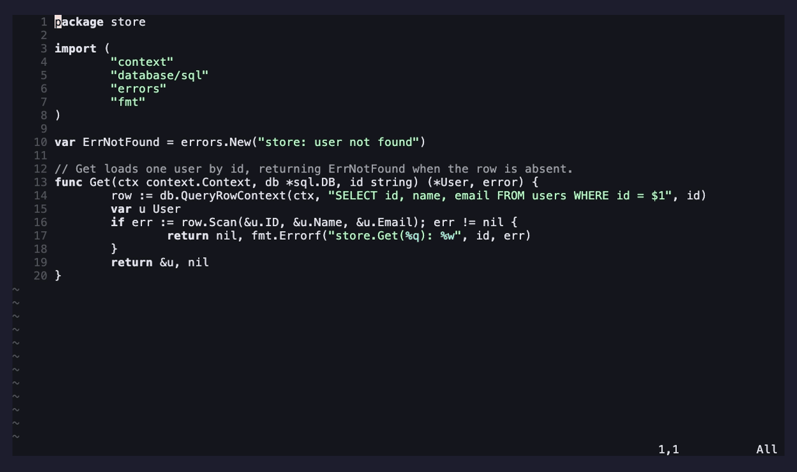

# ami-history.nvim

Conversation history for [ami](https://github.com/moosch/ami.nvim) — a branching
tree with persistence, branch/switch/summarize, and `:AmiTree`.

It provides ami's `history` capability: it supplies the prior-turn messages the chat
controller includes in each request (so chat is multi-turn), and records completed
turns by listening to the chat lifecycle events. History is a tree — point the head
at any earlier node and keep talking to create a divergent branch without losing the
old one; summarize a long prefix to shrink future context non-destructively.

Because it's just a provider, you can swap it for a fancier memory later (semantic
search, summarizing memory, …) by registering a different `history` provider — no
change to ami-chat.

## Demo

The conversation tree — switch to a different branch and the transcript
re-materializes for it (`*` = head, `|` = active path, `~` = collapsed):



> Rendered from [`demos/tree.tape`](demos/tree.tape); see
> [`demos/README.md`](demos/README.md) to (re)generate it (no LM Studio needed).

## Requirements

- [ami.nvim](https://github.com/moosch/ami.nvim) — the runtime.
- [ami-chat.nvim](https://github.com/moosch/ami-chat.nvim) — the chat controller
  whose events this records and whose requests it feeds. **Required**: without chat
  there's nothing to remember.

## Install

With [lazy.nvim](https://github.com/folke/lazy.nvim), install it alongside ami and
ami-chat, and register all three:

```lua
{
  "moosch/ami.nvim",
  dependencies = {
    "moosch/ami-chat.nvim",
    "moosch/ami-history.nvim",
  },
  config = function()
    require("ami").setup({
      extensions = { require("ami-chat"), require("ami-history") },
      -- optional: history = { session_dir = nil },  -- nil = stdpath("data")/ami
    })
  end,
}
```

Without this extension, ami-chat still works but keeps only an in-memory history for
the current session (no persistence, no branching).

## Commands

| Command | What it does |
| --- | --- |
| `:AmiTree` | Open the tree — `<CR>` switch branch, `s` summarize up to a node, `r` refresh, `q` close |

In the tree, `*` marks the head, `|` a node on the active path, `~` a collapsed
(summarized) node; `A`/`U` is assistant/user.

It also adds the **`/compact`** (alias `/compress`) chat slash-command: typed into the
[ami-chat](https://github.com/moosch/ami-chat.nvim) input, it summarizes the whole
conversation so far into one summary — the same non-destructive fold as `s` in the
tree, but up to the latest turn — so future turns carry the summary instead of every
message. The originals stay on disk (switch back to a pre-summary branch in `:AmiTree`).

## Configuration

Config lives under `history` in ami's `setup()`:

| Key | Default | Meaning |
| --- | --- | --- |
| `session_dir` | `nil` | where sessions are stored. `nil` = `stdpath("data")/ami/<project>/sessions/` (out of your repos); `""` = each project's own `./.ami/sessions/` (add `.ami/` to your global gitignore) |
| `tree_side` | `nil` | which side `:AmiTree` docks on: `"left"` / `"right"`. `nil` = auto — the opposite side from the chat panel, so a floating chat never overlaps the tree |
| `keymaps.switch` | `"<CR>"` | switch the active branch to the node under the cursor |
| `keymaps.summarize` | `"s"` | summarize the path up to the node |
| `keymaps.refresh` | `"r"` | reload the tree |
| `keymaps.close` | `"q"` | close the tree window |
| `keymaps.open` | `nil` | optional global normal-mode map for `:AmiTree` (e.g. `"<leader>at"`) |

Each `keymaps.*` value is a string, a list of strings, or `false` to disable it.
(You can also `vim.keymap.set` the `:AmiTree` command yourself.)

## How it works

- Records by listening to `chat_turn_post` (which carries the full user + assistant
  text and the project root).
- Supplies prior turns via `messages(session)` — the active root→head path, with any
  summarized prefix collapsed into a single system message.
- Sessions are keyed per project (basename + a short path hash) so same-named
  projects in different locations don't collide.

> **Per-instance:** history is local to each Neovim instance (there's no shared
> daemon any more). Two instances editing the same project write to the same files;
> last write wins. A future provider could add locking or live reload.

## License

[MIT](LICENSE)
